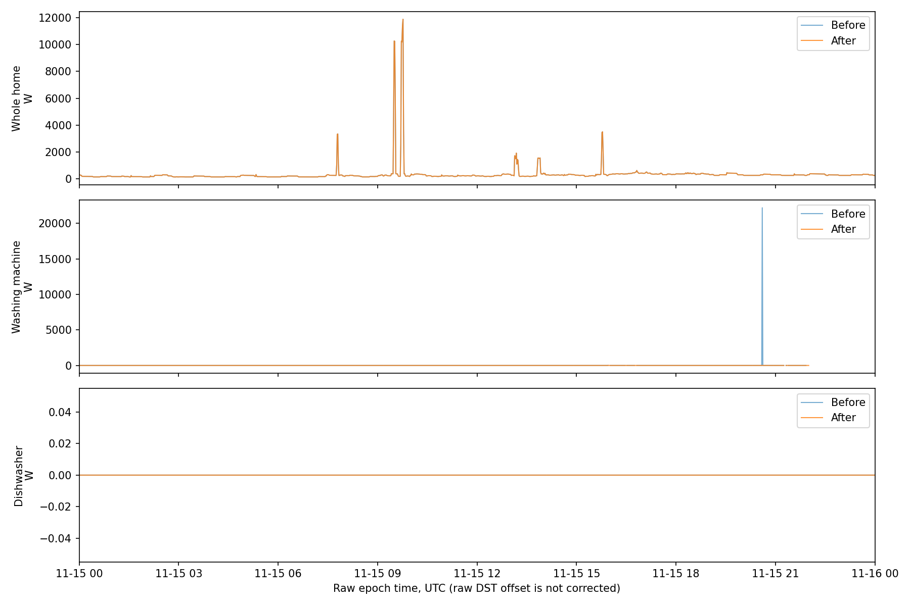
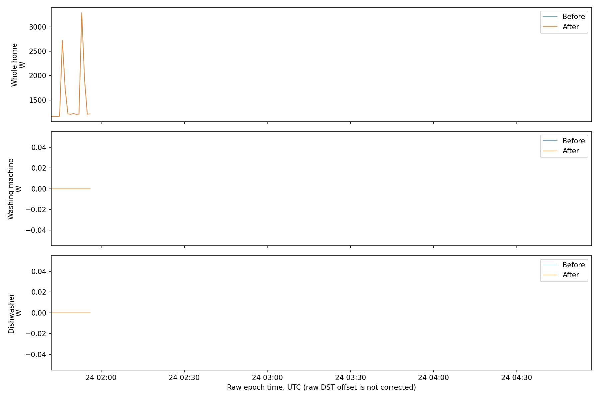

# Data audit and decisions

## Sources and provenance

REFIT, University of Strathclyde, CC BY 4.0. The archive URLs, byte counts and SHA256 checksums are in [source_manifest.json](reports/source_manifest.json). `download_data.py` verifies future downloads against these recorded checksums. Raw and cleaned datasets are **different products**, not independent train/test sets. Archives and household records are deliberately excluded from Git; download them using the documented command. Public source documentation is linked in README, not the private recruiting email/PDF.

The documented nominal interval is 8 seconds, with active power in watts. Sensors are asynchronous (roughly 6–8 seconds). We analyze mean watts on a UTC one-minute grid; energy = sum(W × 1/60 hour)/1000. UK local time is used only for behavioural EDA. House IDs skip 14. House 12 has unknown labels, so it is excluded. Washer-dryer labels are excluded; House 4's two washing-machine channels remain separate. Exact channel mapping is in `pipeline.py:WM`.

## Raw House 1

- Files: `RAW_House1_Part1.csv`, `RAW_House1_Part2.csv`.
- 6,851,359 source rows; 527,797 duplicate epochs (before dropping invalid timestamps).
- Actual epoch coverage: **2013-10-09 14:06:00+00:00 to 2015-07-10 11:56:00+00:00**; 920,031 minute slots.
- Parsing/order/interval details: [raw_quality.json](reports/raw_quality.json). One invalid/header-like row is dropped; Part 1 contains a backward step. Positive median intervals differ by file (5 and 7 seconds), so hard-coding an exact 8-second cadence is inappropriate. Text times differ from epochs by zero/one second, consistent with rounding. The raw clock does not have the official DST correction: treat raw epoch time as a consistent audit clock, not corrected UK calendar time.

| channel | missing | zeros | negative | above_cap | max_w |
| --- | --- | --- | --- | --- | --- |
| Aggregate | 188974.0 | 12.0 | 0.0 | 0.0 | 29159.0 |
| Appliance1 | 437891.0 | 4941086.0 | 0.0 | 510.0 | 76677.0 |
| Appliance2 | 459469.0 | 4251236.0 | 0.0 | 32.0 | 98301.0 |
| Appliance3 | 311962.0 | 3925343.0 | 0.0 | 104.0 | 73725.0 |
| Appliance4 | 510964.0 | 6321551.0 | 0.0 | 811.0 | 98301.0 |
| Appliance5 | 497224.0 | 6214931.0 | 0.0 | 55.0 | 73725.0 |
| Appliance6 | 342338.0 | 6446981.0 | 0.0 | 34.0 | 37610.0 |
| Appliance7 | 232753.0 | 5895525.0 | 0.0 | 163.0 | 98299.0 |
| Appliance8 | 390706.0 | 5304813.0 | 0.0 | 145.0 | 98301.0 |
| Appliance9 | 1911812.0 | 1616.0 | 0.0 | 50.0 | 65535.0 |

## Cleaning policy

1. Convert Unix epochs to UTC timestamps; drop invalid epochs. Inspect text timestamp parsing separately.
2. Stable sort; last source record wins for a duplicate epoch. Part 2 follows Part 1. No summing duplicate power readings.
3. Convert negative values and appliance readings above 5,000 W to missing; aggregate upper cap is 30,000 W. These are broad engineering guardrails, not household electrical ratings. Record counts/maxima for **all** channels. Real aggregate readings up to 29,159 W survive; unusually high plausible values still need manual investigation. Official cleaned IAM cap is 4,000 W and is a separate historical policy.
4. Mean to one-minute bins; require at least three valid readings per channel per minute. This is a documented sample-count proxy, **not proof of 60 seconds of sensor coverage**. A time-weighted integration and raw sensor freshness flags would be a stronger next step.
5. Interpolate bounded missing runs of one or two minutes only. Never partially fill a longer run, fill an edge, or convert an outage to zero. The complete set of channels is cleaned. Gaps/outlier replacement are channel-specific.
6. Preserve remaining missing intervals; `reports/raw_outages.csv` (generated locally) records every remaining run. Interpolated points are for this raw cleaning exercise only; model training uses official cleaned readings with no additional label interpolation.

After cleaning, missing minutes per channel are {'Aggregate': 163985, 'Appliance1': 169824, 'Appliance2': 168690, 'Appliance3': 165462, 'Appliance4': 179757, 'Appliance5': 177121, 'Appliance6': 164077, 'Appliance7': 164005, 'Appliance8': 167344, 'Appliance9': 381050}. Short-gap filled counts are {'Aggregate': 558, 'Appliance1': 2674, 'Appliance2': 2841, 'Appliance3': 858, 'Appliance4': 3039, 'Appliance5': 3008, 'Appliance6': 1285, 'Appliance7': 584, 'Appliance8': 1952, 'Appliance9': 1278}. See measured audit JSON for details.

This is the day of the largest unfiltered one-minute washing-machine load, selected deterministically to expose appliance extremes; the traces include the washing machine and dishwasher. Overlap indicates that ordinary readings were preserved. The plots compare resampled, unfiltered readings against resampled, cleaned readings, rather than every original high-frequency point.

The beginning of the longest aggregate missing run remains blank. This demonstrates outage preservation; blank regions are not off states.

## Official cleaned data limitations

The official README says missing readings were forward-filled, IAM spikes above 4,000 W replaced by zero, and some appliance columns moved to repair monitor changes. Zero can therefore be true off, suppressed spike, or early sensor unavailability. Those distinctions cannot be recovered from the cleaned data alone. Part 1 raw zeros also conflate unavailable/off. A regular minute index does not establish label freshness.

`Issues=1` means summed monitored loads exceed aggregate. **Descriptive appliance EDA retains these flagged readings** and reports flagged minutes and target-above-aggregate counts in [availability.csv](reports/availability.csv); appliance readings can still describe usage while meter totals disagree. Modeling excludes flagged target minutes and target > aggregate, with coverage disclosed. This creates a conservative, conditional benchmark and may exclude difficult overlapping loads. Because Issues is derived from submeter totals, this evaluation quality gate is not generally available to an aggregate-only deployed system; production needs independent meter-health checks and an unfiltered sensitivity benchmark. Aggregate feature windows must have no missing minutes, but issue flags are not model features.

House 13's washing machine changed on 25 March 2015; full-period EDA mixes both eras and should not be interpreted as a single stable appliance comparison. It is excluded from modeling. Other unrecorded swaps remain possible. House 4 has two labelled machines and is excluded from the single-target modeling cohort to keep the target definition unambiguous.

## EDA scope and coverage

All 19 homes with explicit washing-machine labels, 20 appliance channels, use their complete supplied coverage. No claim is made that every home has identical coverage. Missing/unusable counts, zero/off percentages and quality flags are in the CSVs.

| house | channel | start_utc | end_utc | grid_minutes | valid_minutes | events | median_cycle_min | median_cycle_kwh |
| --- | --- | --- | --- | --- | --- | --- | --- | --- |
| 1 | 5 | 2013-10-09 13:06:00+00:00 | 2015-07-10 11:56:00+00:00 | 920091 | 800675 | 384 | 33.0 | 0.311 |
| 2 | 2 | 2013-09-17 22:08:00+00:00 | 2015-05-28 08:05:00+00:00 | 889078 | 665633 | 303 | 97.0 | 0.633 |
| 3 | 6 | 2013-09-25 19:21:00+00:00 | 2015-06-02 10:55:00+00:00 | 885095 | 781095 | 623 | 66.0 | 0.549 |
| 4 | 4 | 2013-10-11 10:19:00+00:00 | 2015-07-07 09:57:00+00:00 | 912939 | 784458 | 59 | 54.0 | 0.89 |
| 4 | 5 | 2013-10-11 10:19:00+00:00 | 2015-07-07 09:57:00+00:00 | 912939 | 784458 | 206 | 51.0 | 0.654 |
| 5 | 3 | 2013-09-26 09:56:00+00:00 | 2015-07-06 17:48:00+00:00 | 933593 | 839891 | 700 | 42.0 | 0.275 |
| 6 | 2 | 2013-11-28 12:15:00+00:00 | 2015-06-28 22:14:00+00:00 | 831480 | 700313 | 115 | 129.0 | 0.672 |
| 7 | 5 | 2013-11-01 22:01:00+00:00 | 2015-07-08 02:10:00+00:00 | 882970 | 766694 | 818 | 60.0 | 0.545 |
| 8 | 4 | 2013-11-01 22:13:00+00:00 | 2015-05-10 23:36:00+00:00 | 799284 | 711735 | 359 | 60.0 | 0.786 |
| 9 | 3 | 2013-12-17 17:26:00+00:00 | 2015-07-08 18:52:00+00:00 | 818007 | 686934 | 239 | 74.0 | 0.659 |
| 10 | 5 | 2013-11-20 11:31:00+00:00 | 2015-06-30 11:07:00+00:00 | 845257 | 742449 | 569 | 120.0 | 0.711 |
| 11 | 3 | 2014-06-03 11:36:00+00:00 | 2015-06-30 15:12:00+00:00 | 564697 | 497838 | 106 | 51.0 | 0.392 |
| 13 | 3 | 2014-01-17 22:26:00+00:00 | 2015-05-31 11:06:00+00:00 | 717881 | 543186 | 311 | 69.0 | 0.452 |
| 15 | 3 | 2013-12-17 17:24:00+00:00 | 2015-07-08 02:10:00+00:00 | 817007 | 700767 | 256 | 90.0 | 0.676 |
| 16 | 5 | 2014-01-10 10:58:00+00:00 | 2015-07-08 02:10:00+00:00 | 782833 | 643644 | 294 | 73.0 | 0.628 |
| 17 | 4 | 2014-03-06 16:23:00+00:00 | 2015-06-19 14:52:00+00:00 | 676710 | 629927 | 304 | 57.0 | 0.369 |
| 18 | 5 | 2014-03-07 10:33:00+00:00 | 2015-05-24 11:34:00+00:00 | 637982 | 597716 | 133 | 48.0 | 0.316 |
| 19 | 2 | 2014-03-06 16:23:00+00:00 | 2015-06-20 03:32:00+00:00 | 677470 | 628377 | 246 | 102.0 | 0.242 |
| 20 | 4 | 2014-03-20 12:01:00+00:00 | 2015-06-23 19:44:00+00:00 | 662864 | 619043 | 183 | 74.0 | 0.372 |
| 21 | 3 | 2014-03-07 16:20:00+00:00 | 2015-07-10 11:56:00+00:00 | 705337 | 635213 | 230 | 86.0 | 0.621 |

The cleaned records' actual dates, including some July 2015 coverage, take precedence over the dataset page's approximate temporal summary. Nominal cadence is distinct from empirically observed interval distributions.
