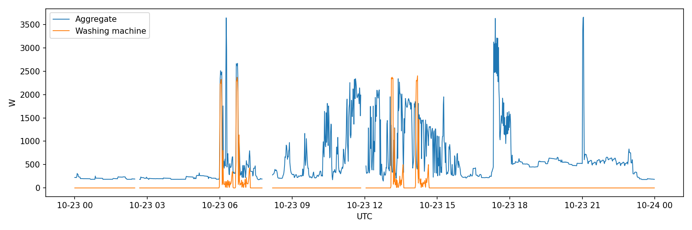
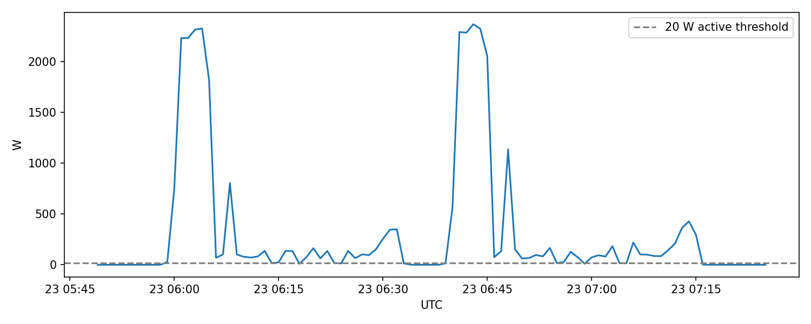
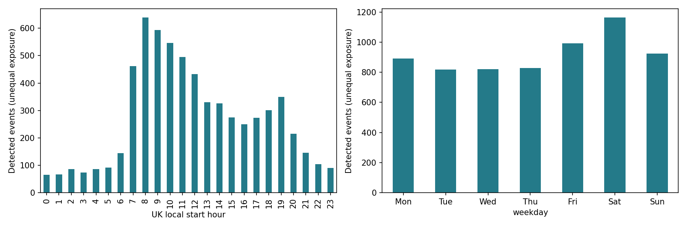
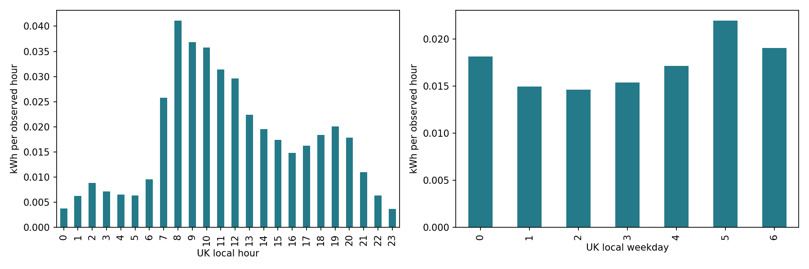
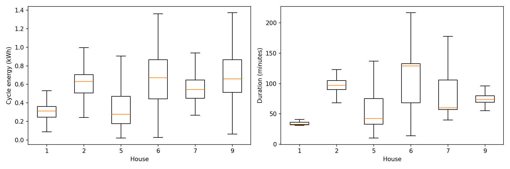
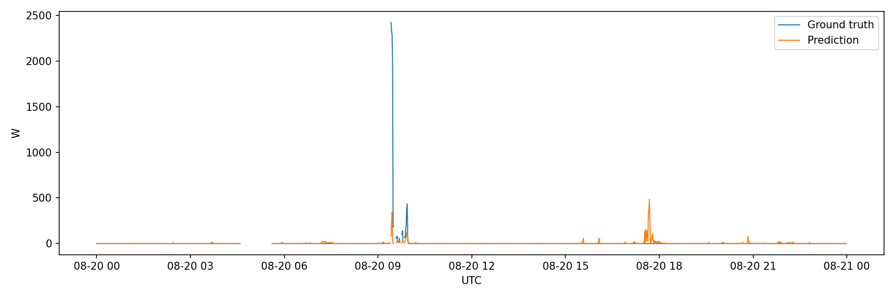
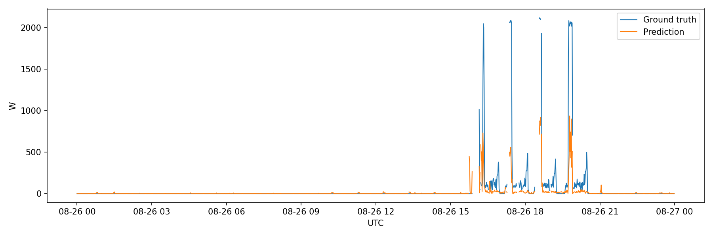
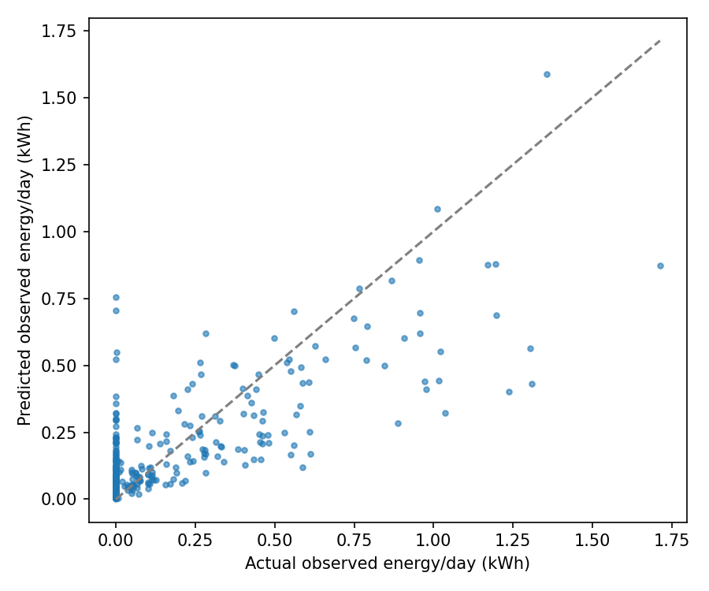

# Measured results and interpretation

## Washing-machine EDA

There are **6,438 detected candidate operating events** across 19 houses / 20 channels. An active minute is >20 W. Merge active portions across at most ten **observed** off minutes; never bridge missing labels. Retain events at least ten minutes long and at least 0.02 kWh; reject events touching dataset/missing-data boundaries. These are heuristic operating events, not verified wash cycles: long pauses can split cycles, close washes can merge, and cold washes/standby can confuse detection. Report counts after the rule, not assumed household wash frequency.

Event-count sensitivity (full supplied coverage):

| threshold_w | bridge_min | events |
| --- | --- | --- |
| 10 | 10 | 6411 |
| 20 | 5 | 6660 |
| 20 | 10 | 6438 |
| 20 | 15 | 6282 |
| 50 | 10 | 6604 |

The event-count peak is local hour **8:00** and **Saturday**, but homes have unequal exposure. Use the normalized energy chart below for exposure-aware comparisons, rather than concluding which day is intrinsically preferred from counts alone.

Whole-home consumption contains substantial activity unrelated to the washing machine. The day is the first House 1 event in the 45–180 minute / 0.3–2 kWh range (first detected event fallback). It is a descriptive example, not a random sample or performance-selected trace.

Heating, agitation and lower-load phases yield a multi-state signature. The 20 W threshold captures operating portions; it does not identify programme temperature or load size.

Event start counts by local hour/day show scheduling patterns but reflect uneven household coverage.

Energy divided by observed minute exposure (scaled to an observed hour) avoids treating unobserved periods as zero. It includes all valid appliance minutes, not just accepted events; it is pooled/exposure weighted, not an equal-household average.

Energy/duration vary across selected homes. Boxes omit outlier markers for readability; all events remain in the CSV. Appliance model, wash setting, laundry size and event fragmentation are confounders. Higher energy does not prove appliance inefficiency.

## Experiment design

- Train: Houses **1, 2, 5, 6, 9**, 1 March–30 June 2014.
- Validation: same homes, July 2014.
- Locked chronological test: same homes, August 2014.
- Unseen-house test: **House 7**, August 2014, never used for training/model selection.
- Thirty minutes are purged at **both ends of every split**. A 61-minute centred feature window must lie wholly within its partition, producing a 60-minute separation across adjacent partitions. Missing context windows and invalid labels are excluded before sampling.
- 754,739 eligible training minutes; a fixed-seed uniform subset of 180,000 is used. Validation/test are unsampled and retain the natural class imbalance. No global scaling, feature selection or oversampling uses held-out data. No household ID, calendar, Issues, target lags, appliance power or energy-derived features enter the model.

The model is a compact **gradient-boosted sequence-to-point regressor**, not a reproduction of the Seq2Point CNN. Aggregate values at 13 offsets and centred rolling mean/std/min/max at four spans, plus a first difference, represent the surrounding signature. The longest span is 61 minutes. It is **offline**, requiring 30 minutes of future aggregate readings; it is not a real-time causal estimator. For causal operation retrain with trailing windows and reevaluate.

Both squared-error and absolute-error objectives use 140 boosting iterations, 31 leaves, minimum 50 rows/leaf, learning rate 0.08, L2=1 and seed 42. Internal random early stopping is disabled. Validation chooses the loss minimizing `MAE + 50 × relative energy error`; this illustrative energy-aware weight is declared in code, not a utility-calibrated cost. The selected loss is **squared_error**. The absolute-error candidate collapses to off predictions under extreme class imbalance, illustrating why MAE alone is insufficient. No hyperparameters are selected on either test. Output is clipped to [0, aggregate] without consulting appliance labels.

## Baseline comparison

**All figures below are produced by running the supplied pipeline on actual REFIT files.**

| split | model | n | mae_w | rmse_w | active_mae_w | f1 | relative_energy_error |
| --- | --- | --- | --- | --- | --- | --- | --- |
| test | zero | 184576 | 7.087 | 98.036 | 290.536 | 0.0 | 1.0 |
| test | training_mean | 184576 | 15.028 | 97.799 | 281.49 | 0.0 | 0.276 |
| test | sequence_gbdt | 184576 | 9.643 | 75.602 | 208.854 | 0.338 | 0.053 |
| unseen | zero | 37662 | 22.109 | 185.892 | 422.426 | 0.0 | 1.0 |
| unseen | training_mean | 37662 | 30.016 | 185.034 | 413.38 | 0.0 | 0.591 |
| unseen | sequence_gbdt | 37662 | 26.295 | 144.183 | 312.142 | 0.479 | 0.137 |

Energy error is |sum(pred)−sum(true)|/sum(true), dimensionless (0.05=5%). It can hide opposing daily/home errors. MAE/RMSE are watts. Active MAE uses truth >20 W. F1 uses predicted >20 W. Average precision is also supplied in [metrics.csv](reports/metrics.csv) because prevalence is low. The training-mean baseline is learned from training only, capped by aggregate; zero predicts no use.

The sequence model improves RMSE, active-period error and energy capture versus zero. Overall MAE remains worse than zero, and activity F1 is modest. This is a defensible prototype for coarse energy feedback, **not precise appliance identification**. Pooled energy accuracy is insufficient evidence for household billing or control.

Per-home breakdown:

| split | house | n | mae_w | rmse_w | f1 | observed_true_kwh | observed_pred_kwh | relative_energy_error |
| --- | --- | --- | --- | --- | --- | --- | --- | --- |
| test | 1 | 38447 | 5.513 | 48.007 | 0.357 | 1.696 | 2.525 | 0.488 |
| test | 2 | 39016 | 12.957 | 102.434 | 0.353 | 7.342 | 6.112 | 0.168 |
| test | 5 | 30846 | 10.494 | 63.611 | 0.209 | 3.408 | 3.934 | 0.154 |
| test | 6 | 37592 | 8.438 | 70.1 | 0.367 | 4.057 | 3.65 | 0.1 |
| test | 9 | 38675 | 10.901 | 79.986 | 0.419 | 5.299 | 6.741 | 0.272 |
| unseen | 7 | 37662 | 26.295 | 144.183 | 0.479 | 13.878 | 11.97 | 0.137 |

Eligible model coverage (after the context embargo):

| house | split | embargoed_grid_minutes | eligible_minutes | eligible_pct |
| --- | --- | --- | --- | --- |
| 1 | train | 175620 | 158453 | 90.22 |
| 1 | validation | 44580 | 40921 | 91.79 |
| 1 | test | 44580 | 38447 | 86.24 |
| 2 | train | 175620 | 160052 | 91.14 |
| 2 | validation | 44580 | 41759 | 93.67 |
| 2 | test | 44580 | 39016 | 87.52 |
| 5 | train | 175620 | 145739 | 82.99 |
| 5 | validation | 44580 | 31497 | 70.65 |
| 5 | test | 44580 | 30846 | 69.19 |
| 6 | train | 175620 | 156115 | 88.89 |
| 6 | validation | 44580 | 40897 | 91.74 |
| 6 | test | 44580 | 37592 | 84.32 |
| 9 | train | 175620 | 134380 | 76.52 |
| 9 | validation | 44580 | 40891 | 91.72 |
| 9 | test | 44580 | 38675 | 86.75 |
| 7 | unseen | 44580 | 37662 | 84.48 |

Exclusion reasons in [split_coverage.csv](reports/split_coverage.csv) overlap and cannot be summed. All energy totals are for **eligible observed test minutes only**, not complete monthly bills. Compare only matched masks; excluded minutes have no estimate. `reports/daily_energy.csv` (generated locally) reports evaluated minutes, so low-coverage days can be identified. [uncertainty.json](reports/uncertainty.json) provides 500 day-block bootstrap intervals on energy error, conditional on the selected homes. These do not estimate general uncertainty across all UK or Indian households.

Highest actual-energy August test day in House 1, chosen to make appliance activity visible. It is intentionally labelled an illustrative, high-activity example; it is not cherry-picked for low error. Actual/prediction differences show signature ambiguity and amplitude error.

Same deterministic selection for House 7. A new household can introduce unseen appliance/load combinations; no adaptation is performed.

Distance from the diagonal exposes daily errors which may cancel in pooled energy totals. `reports/worst_days.csv` (generated locally) ranks the worst daily absolute energy errors without hiding failures.

## Failure analysis and limitations

1. Dishwashers, kettles, heaters and other simultaneous loads can resemble washing-machine heating. The low precision and nonzero off MAE show false positives; missed motor/low-load phases contribute to active MAE.
2. The 61-minute engineered representation is compact but cannot represent every multi-hour programme. Longer sequences / CNNs / TCNs need budgeted comparison against these same splits, not a claim of superiority without a test.
3. Source forward filling and zero replacement may produce stale/misleading labels. Filtering Issues and target > aggregate removes some difficult minutes; results are conditional on this quality gate.
4. Five training homes, one unseen home and one summer month do not establish seasonal or population generalization. A household-grouped cross-validation with multiple untouched homes is the next validation priority.
5. Appliance changes (including House 13), occupancy, behaviour and unmetered loads matter. Nine IAMs never measure every load, and asynchronous sampling can cause apparent physical inconsistency.

## 15-/30-minute resolution

Averaging reduces heating peaks and merges brief phases and overlapping loads. Long-window energy advice may remain possible, but exact event boundaries/signature separation worsen and duration uncertainty increases. [resolution_sensitivity.csv](reports/resolution_sensitivity.csv) averages matched 1-minute truth and predictions into complete 15/30-minute bins. It measures **smoothing of existing predictions only**, not performance of a model trained on coarse aggregate meters. Apparently improved errors/F1 after smoothing are not evidence that coarse input is equally informative. A real coarse-meter experiment must resample inputs first, retrain, retain household/time splits and evaluate energy and event detection separately.
